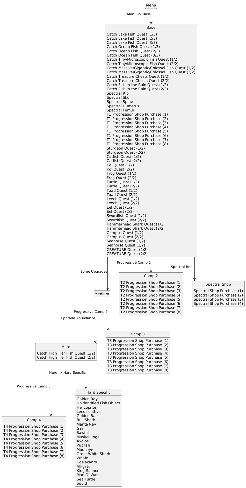
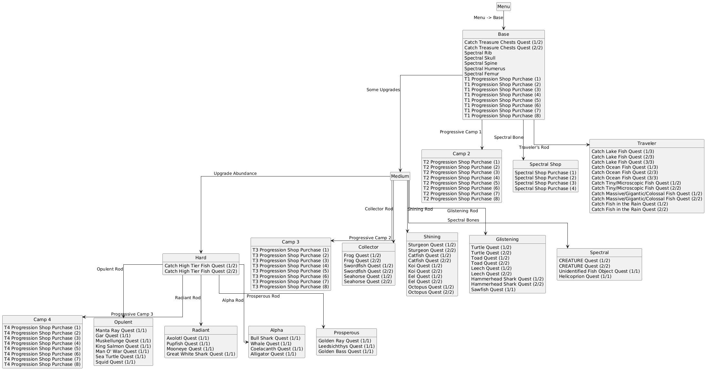

# WEBFISHING

## What does randomization do to this game?

Most of your usual progression -- rod/bait upgrades, camp tier unlocks, lures, and the spectral
bones -- is removed from its normal purchase/quest flow and placed into the multiworld instead.
Completing quests (catch quests, both generic and specific-fish) and making shop purchases send
checks; receiving the matching item from the multiworld is what actually grants the upgrade.

Two Game Modes control how fish themselves behave:
- **Classic**: normal WEBFISHING fishing odds throughout -- any fish can appear at any time,
  same as vanilla.
- **Harmonized**: each fish species is tied to a specific rod tier's loot pool (which rod you
  need to even encounter it), and fish quality is guaranteed by which bait you use rather than
  being a random roll. Based on [Eszenn's Archipelago Tweaks mod](https://github.com/Eszenn/Webfishing-Archipelago-Tweaks/tree/main)
  -- see [`loottables.md`](loottables.md) for the exact per-rod groupings.

An optional **FishSanity** toggle adds a check for the first time you log each species at each of
the game's six quality tiers (Normal, Shining, Glistening, Opulent, Radiant, Alpha) in your
journal -- this covers everything catchable, junk items included, not just "real" fish. It's a
large jump in location count (roughly 4.5x more locations than the base ruleset), so expect a
much more filler-heavy item pool if you turn it on.

## What is the goal?

Choose one when generating:
- **Total Journal Completion**: reach a configured percentage of total journal completion (every
  fish, every quality).
- **Rank**: reach a configured in-game rank.
- **Camp**: unlock and purchase the final camp tier.

## What items and locations get shuffled?

**Items**: progressive rod power/speed/luck/chance upgrades, tacklebox upgrades, bait tiers,
lures and hooks, progressive buddy upgrades, progressive camp tier unlocks, the five spectral
bones, and (Harmonized mode only) the named rods themselves. Everything else in the pool is
filler -- treasure chests, consumables (drinks, scratch-offs), and money.

**Locations**: generic and specific-fish catch quests, one-time misc pickups (the spectral
bones), and shop purchases across every camp tier and the spectral shop. With FishSanity on, add
one location per (species, quality) combination logged in your journal.

## What does another world's item look like in WEBFISHING?

Received items apply immediately with an in-game notification (e.g. "Progressive Rod Power
Upgrade obtained through Archipelago!") -- no separate menu to check. Shop items you haven't
received yet are shown locked, with a note that they must come through Archipelago.

## Region logic

Due to the nature of the game, it's possible to skip ahead of the upgrade requirements below --
they're only there to ensure enough upgrades are in logic, not hard barriers.

### Classic

### Harmonized

